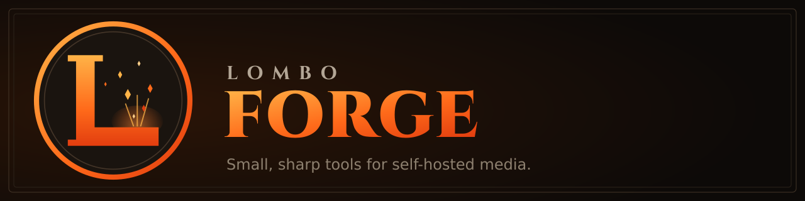

  
  
  

# Lombo

The hub of [Lombo Forge](https://github.com/Lombo-Forge): small, open-source tools for people who run their own media
server. Each tool does one job, lives in its own repository and works without this one. This repo holds the three things
they share: the **plugin repository manifest**, the **brand assets**, and the **list of tools**.

None of it is affiliated with or endorsed by the Jellyfin project; "for Jellyfin" only says what it works with.

## Contents

- [The tools](#the-tools)
- [Install the plugin from the manifest](#install-the-plugin-from-the-manifest)
- [Brand assets](#brand-assets)
- [Make your own](#make-your-own)
- [Contributing](#contributing)

## The tools

| Tool | What it does | Repository |
|---|---|---|
| **LomboTier** | Moves movies and seasons between SSD and HDD based on what people actually watch (mergerfs). | [lombo-tier](https://github.com/Lombo-Forge/lombo-tier) |
| **LomboShrink** | Uses the discrete graphics card in your main PC to re-encode a library to H.265, then swaps the smaller files in safely. | [lombo-shrink](https://github.com/Lombo-Forge/lombo-shrink) |
| **LomboShelf** | A streaming-style home screen and theme for Jellyfin's web client, as a plugin. | [jellyfin-plugin-lomboshelf](https://github.com/Lombo-Forge/jellyfin-plugin-lomboshelf) |
| **LomboNudge** | Finds requests that were approved but never arrived, and says why. | [lombo-nudge](https://github.com/Lombo-Forge/lombo-nudge) |
| **LomboNap** | Asks "Still watching?" and stops playback nobody is watching; reports what woke your sleeping disks. | [lombo-nap](https://github.com/Lombo-Forge/lombo-nap) |
| **Template** | Starting point for your own small Jellyfin companion app. | [lombo-jellyfin-template](https://github.com/Lombo-Forge/lombo-jellyfin-template) |

Every tool is dry-run by default and says plainly in its README what has and has not been verified against real systems.

## Install the plugin from the manifest

LomboShelf is the one tool installed through Jellyfin itself. No version is published yet, so the manifest lists the
plugin with no versions. Once there is a release: Jellyfin dashboard, **Plugins**, **Repositories**, **Add**, and paste the
raw URL of `manifest.json` from this repo's `main` branch. LomboShelf also needs the File Transformation plugin; see its README.

## Brand assets

`brand/` has the Lombo Forge logo and banner and, under `brand/apps/`, every tool's icon and banner. The Lombo **L** is in
every icon. How the artwork is made and what the palette is: [docs/branding.md](docs/branding.md). Artwork is GPL-3.0 like
the code; the Cinzel font is under the SIL Open Font License ([NOTICE.md](NOTICE.md)).

## Make your own

Click **Use this template** on [lombo-jellyfin-template](https://github.com/Lombo-Forge/lombo-jellyfin-template), run one
script, replace one function.

## Contributing

Issues and pull requests are welcome. The short rules are in the organisation's
[CONTRIBUTING](https://github.com/Lombo-Forge/.github/blob/main/CONTRIBUTING.md); `AGENTS.md` here is the map for an AI agent.
